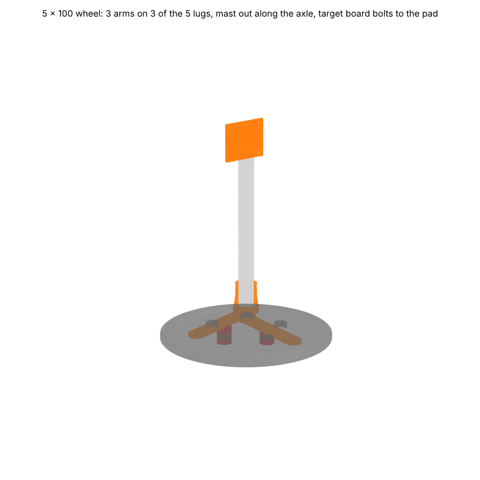

# aligndeck

Camera wheel alignment for the home garage. You print a few targets, bolt them to the wheels with a 3D-printed
lug frame, and take photos with any camera. aligndeck measures **camber and toe**, compares them with the car's
specs, and tells you exactly how far to turn each adjuster:

> RIGHT FRONT toe: now +0.21°, goal +0.05° -> change -0.16°. Move 1 1/4 turns opposite of: clockwise viewed from
> inside the car.

It runs on a laptop, a desktop, or an RK3588 board such as an Orange Pi 5. The screen is a web page, so you can
run it on a small board in the garage and watch it from another computer over Tailscale.



## How it measures

**Front view (main method).** Each wheel of an axle carries a target on a lug frame, sticking out past the fender
and facing the camera. A third target lies flat on the floor. You take a photo, roll the car about a foot (1/8 of a
wheel turn), and take another; three photos is best. Rolling turns each target around the wheel's real spin axis,
which the app recovers from the rotation between photos. **The frame doesn't have to be square to the wheel**: the
mounting error drops out. The floor target gives "up", and the result is camber per wheel and total toe.

**Side view (fallback).** The target is clamped flat on the wheel, with the floor target on a string line. You
measure the string-to-hub distances and the app removes the string's angle. A second reading with the clamp turned
half a turn cancels clamp tilt. This method gives per-wheel toe and thrust angle.

**From angle to turns.**

- **Guided calibration** (best): photos, turn one tie rod a known amount (default 1/2 turn), photos again. The
  change in total toe is that adjuster's degrees per turn, and which way, measured on your car. It is used for
  both sides (mirror parts), and needs no thread pitch.
- **A rate from the service manual** (e.g. "one graduation = 0°10'"), only after you pick it for that adjuster.
- **Thread pitch estimate**: toe per turn = atan(pitch × threads ÷ steering-arm length), direction confirmed by a
  test turn.

Turns are rounded to 1/8, and the goal is the center of the spec.

Synthetic photos read back within **0.03°** at 3000 px, including frames mounted 2-4° crooked. It's a home tool:
confirm against a shop alignment before trusting it for tire wear.

## What you need

| | |
|---|---|
| Camera | Any camera libgphoto2 can drive over USB (tested in code with a Nikon D750 + 50 mm), a webcam, or photos copied off an SD card |
| Targets | `targets/alignment_targets_letter.pdf` (left wheel, right wheel, floor), printed at **100%** and glued to something stiff and flat |
| Lug frames | `hardware/lug_frame/`: universal 3D-printed frames, both wheels on one 220 × 220 bed. A no-print version also works (see its README) |
| Computer | Linux with Python 3.10+. For the optional NPU vision model, an RK3588 board |

## Install and run

```sh
git clone https://github.com/charlie-nolan/aligndeck && cd aligndeck
python -m venv .venv && .venv/bin/pip install -e .
sudo apt install gphoto2          # or: sudo pacman -S gphoto2
.venv/bin/aligndeck --make Subaru --model Forester --year 2002 --open
```

It listens only on localhost and your Tailscale address, never on the local wifi, and never starts by itself. Data
(per-car state, photos, camera calibration, models) lives in `~/.local/share/aligndeck`, or `$ALIGNDECK_HOME`.

## The screen

Alt+1..5 switch tabs. F7 photo, F8 compute (front view). F5/F6 side view. Alt+L live view.

1. **SPECS**: type the alignment specs from the service manual, or point `--kb` / `--kb-dir` at a spec database
   (the make databases of the Open Diagnostic Cyberdeck use this layout, and every value then shows its source).
2. **CAMERA**: pick the camera and calibrate it once with about 20 photos of the left target, covering the frame
   corners too. Aim for under 0.5 px.
3. **MEASURE**: front view or side view, with a results table and verdicts.
4. **ADJUST**: CALIBRATE TOE ADJUSTER (guided), rates, and the move list.
5. **FULL COMPUTE**: lists programs using CPU, GPU or NPU time, and **pauses** the ones you tick (SIGSTOP; nothing
   is killed). They are resumed when you press RESUME or quit, or on the next start after a crash
   (`aligndeck --resume`).

Live view (gphoto2 `--capture-movie`) outlines every marker it sees, so you can aim the tripod before shooting.

## Vision model helper (optional, notes only)

It never measures, never sets a spec, and never changes a reading.

- OpenCV checks on every photo: soft focus, glare, targets cut off at the frame edge.
- **Qwen2.5-VL-3B** looks at each photo once the measuring is done and adds notes such as "a jack is in front of
  the right target", labelled *may be wrong*. It can also read the **tire size** off a sidewall photo, which goes
  in only when you press USE IT.
- Backends: **Ollama** (`ollama pull qwen2.5vl:7b`, then `--ollama http://host:11434`), or an **RK3588 NPU**:
  `tools/export_qwen25vl_rkllm.sh` on an x86 PC (needs Rockchip's rkllm-toolkit), then
  `tools/build_vlm_runner_rk3588.sh` on the board.

## Layout

```
aligndeck/        the app: align_math (geometry + turns), align_vision (targets, calibration, pose, spin axis),
                  align_specs (spec/rate/direction extraction), session, server, liveview, focus, vlm, web/
tests/            synthetic tests (rendered target photos with known camber/toe, the whole app through its API)
targets/          printable targets
hardware/         lug frame STLs and generators (make_lug_frame.py, make_plates.py)
tools/            vision model build scripts
```

Tests: `python -m unittest discover -s tests -v`

## Status

The math, the app and the tests are done. **Not yet validated on a real car**: that's next. Issues and photos of
real runs are welcome.

## License

GPL-3.0-or-later. Service-manual data is never included. Bring your own specs.
