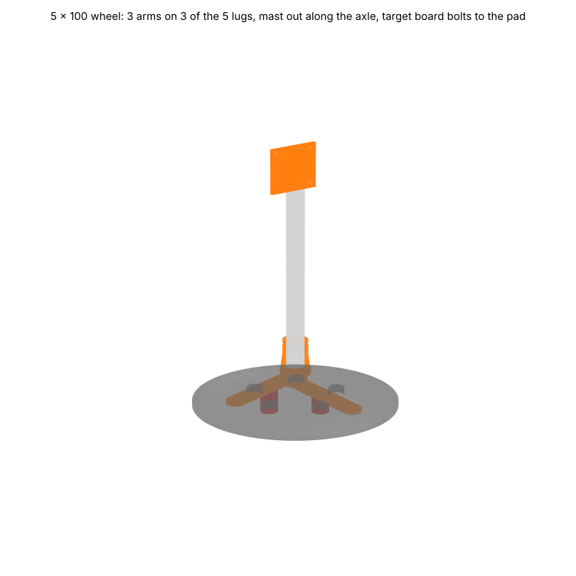

# Universal lug frame (quick print)

One frame per wheel. Fits 4, 5, 6 and 8 lug wheels with bolt circles from about 56 to 204 mm, and any lug nut size,
because the posts sit on the END of the nut (or the stud) instead of around the hex. A magnet in each post holds it.
The three arms pivot on one center bolt, so you swing them to any three lugs (4-lug: any 3; 5-lug: any 3; 6 or 8:
every other one) and slide each post along its arm to the bolt circle. It doesn't have to be square to the wheel:
rolling the car finds the real spin axis.

## Print

**Ender 3 Pro, one plate for both wheels:** `stl/plate_2sets_ender3_220mm_mast_21p34mm.stl` (1/2" PVC mast) or
`..._19p05mm.stl` (3/4" dowel). It's 214 x 208 mm, so let the slicer center it, and use no skirt or a skirt 2 mm
away (a brim won't fit). It holds 6 arms, 6 posts (the 1, 2 and 3 groove posts twice), 2 hubs and 2 target
mounts.

PLA+: 0.28 mm layers, 2 walls, 15% gyroid, 210-220 °C nozzle and 60 °C bed, no supports. It's about 130 g and
roughly 6-8 hours on a stock Ender 3 Pro. (Estimated from the part volumes, not sliced.)

Single parts are in `stl/` too, if one breaks: `arm.stl`, `post_*`, `hub_*`, `target_mount_*`, and
`post_extra_45mm.stl` (only for wheels whose center cap sticks out past the lug nuts). Other rod size:
`python make_lug_frame.py --mast <OD mm>`, then `python make_plates.py --mast <OD mm>`.

## Hardware (per wheel)

- 1 x M8 bolt, 50 mm, plus washer (center pivot). The M8 nut presses into the bottom of the hub: the hub is the knob.
- 3 x M6 bolt, 16-20 mm, plus washers. M6 nuts press into the top of each post: the post is the knob.
- 3 x 12 x 3 mm neodymium disc magnets, glued (CA/epoxy) into the post ends.
- 1/2" PVC pipe (or 3/4" dowel), cut so the target sits past the fender, about 30-35 cm.
- Target sheet glued to foam board or 3 mm plywood, fixed to the 70 x 60 mm pad with 4 x M4 bolts, zip ties or double-sided tape.
- Zip ties around the slit top of the hub socket and through the mount's slot to lock the pipe.

## Assemble

1. Stack the arms on the M8 bolt, bolt head toward the wheel: arm with post 1 nearest the wheel, then 2, then 3.
2. Thread the hub on top and leave it loose. Swing the arms to three lugs, slide the posts to the nuts, snug the
   posts, then turn the hub to lock the arm angles.
3. Turn the pad so the target faces the camera (straight ahead or straight back).
4. Aluminum lug nuts or wheel locks won't hold a magnet: run a bungee or zip tie from the arm-end slots through the
   spokes.
